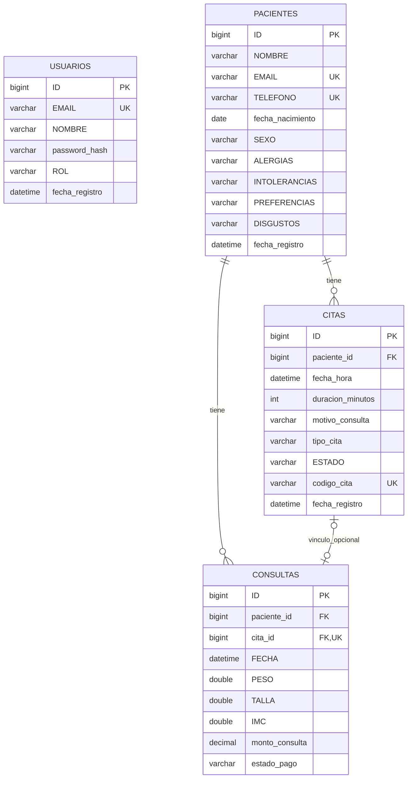
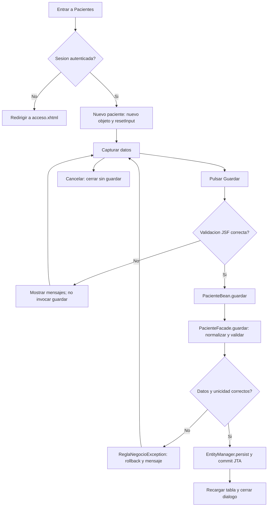
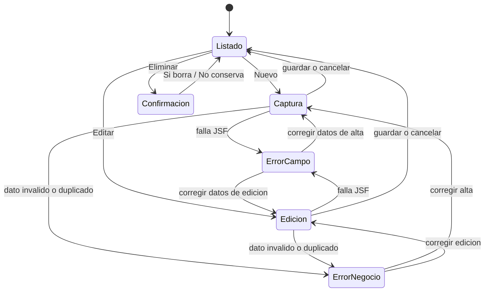
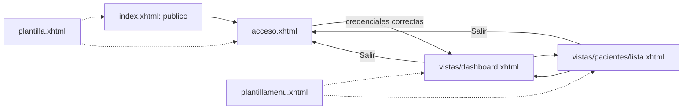

# Unidad 4: modelos, implementación y demostración

Fecha de revisión: 15 de noviembre de 2026. Proyecto: Sistema de Nutrición. Base del código revisado: commit `cb632b1`; las correcciones y documentos de esta revisión son cambios locales posteriores.

## 1. Interpretación de la solicitud del profesor

Fuente de los requisitos de la entrega: explicación transcrita por el estudiante en este chat. No se encontró una rúbrica o formato de entrega independiente en `ARCHIVOS`.

Se pide poder explicar y demostrar la correspondencia entre **historias de usuario, modelo de datos, tablas, comportamiento, secuencias, plantillas, funcionamiento y validaciones**. El profesor revisará el programa a partir de su documentación. El lunes habrá un cuestionario sobre esos conceptos y su implementación; el martes se mostrará el avance.

Si se refiere al lunes y martes inmediatamente posteriores a la revisión, son **16 y 17 de noviembre de 2026**. Confirmar las fechas académicas reales: la transcripción no las especifica. «Fanpages» se interpreta provisionalmente como **Facelets**, porque el estudiante no escuchó con claridad y el contexto es JSF/plantillas. No hay evidencia de que se haya pedido una página de Facebook.

El avance comprobable se concentra en **sitio público, acceso, panel y gestión básica de pacientes conectada a MySQL**. Este documento describe ese comportamiento y sus límites. El README conserva el objetivo completo de 44 historias; no se cambió el objetivo para hacerlo coincidir artificialmente con el avance.

## 2. Correspondencia de lo pedido con los entregables

| Petición | Evidencia que se debe mostrar |
|---|---|
| Modelo de datos implementado | Diagrama de la sección 3, entidades JPA, `persistence.xml`, tablas y FK en MySQL. |
| Plantillas de interfaz / Facelets | `plantilla.xhtml` y `plantillamenu.xhtml`; mostrar `ui:insert`, `ui:composition` y `ui:define` en páginas reales. |
| Modelo de comportamiento | Casos de uso, actividades y estados de interfaz de la sección 4; ejecutar las ramas válidas e inválidas. |
| Diagrama de secuencia | Sección 5; abrir los métodos y ejecutar el mismo recorrido en navegador. |
| Historias de usuario | README y matriz de la sección 7; señalar lo parcial y lo pendiente. |
| Validadores | Sección 6, pruebas Java y prueba del navegador; enseñar que un dato inválido no se guarda. |
| Funcionamiento conectado a la base | Alta ficticia, recarga, nueva sesión, edición, consulta de la fila y eliminación exclusiva de la prueba. |
| Material y herramientas | [Índice del profesor](MATERIALES_PROFESOR.md), con páginas, ubicaciones y decisión sobre instalaciones. |
| Preparación del cuestionario | [Preguntas y ejercicio](GUIA_CUESTIONARIO.md). |

## 3. Modelo de datos, contrastado con MySQL

El diagrama y el diccionario de este apartado corresponden a las cuatro tablas verificadas del 15 al 16 de noviembre. Las actualizaciones del 25 y 26 de noviembre se detallan al final de la sección.



En ese modelo inicial, `USUARIOS` quedaba separado. Una cita pertenece a un paciente y una consulta pertenece a un paciente con cita opcional. `consultas.cita_id` admite NULL y es único.

### Diccionario de datos

Los nombres con mayúsculas son los observados en MySQL; los nombres explícitos con guion bajo vienen de `@Column` o `@JoinColumn`.

| Tabla | Columnas y reglas físicas actuales |
|---|---|
| `usuarios` | `ID BIGINT` PK/autogenerado; `EMAIL VARCHAR(120)` obligatorio/único; `NOMBRE VARCHAR(120)` obligatorio; `password_hash VARCHAR(200)` obligatorio; `ROL VARCHAR(20)` obligatorio; `fecha_registro DATETIME` obligatoria. |
| `pacientes` | `ID BIGINT` PK/autogenerado; `NOMBRE VARCHAR(120)`, `EMAIL VARCHAR(120)` único, `TELEFONO VARCHAR(20)` único, `fecha_nacimiento DATE` y `fecha_registro DATETIME`: obligatorios. `SEXO VARCHAR(15)` y `ALERGIAS`, `INTOLERANCIAS`, `PREFERENCIAS`, `DISGUSTOS`, cada uno `VARCHAR(1000)`: opcionales. |
| `citas` | `ID BIGINT` PK/autogenerado; `paciente_id BIGINT` FK obligatoria; `fecha_hora DATETIME`, `duracion_minutos INT`, `motivo_consulta VARCHAR(1000)`, `tipo_cita VARCHAR(20)`, `ESTADO VARCHAR(20)`, `fecha_registro DATETIME`: obligatorios. `codigo_cita VARCHAR(12)` opcional/único. |
| `consultas` | `ID BIGINT` PK/autogenerado; `paciente_id BIGINT` FK obligatoria; `cita_id BIGINT` FK opcional/única; `FECHA DATETIME` y `estado_pago VARCHAR(20)` obligatorios. Mediciones opcionales DOUBLE: `PESO`, `TALLA`, `IMC`, `grasa_corporal`, `masa_muscular_kg`, `porcentaje_agua`, `CINTURA`, `CADERA`. Textos opcionales: `MOTIVO VARCHAR(500)`, `NOTAS`, `DIAGNOSTICO`, `OBJETIVO` de 2000, `plan_nutricional` de 4000. `proxima_cita DATE`, `monto_consulta DECIMAL(10,2)`, `metodo_pago VARCHAR(20)`: opcionales. |

La edad se calcula desde la fecha de nacimiento: no hay columna EDAD. El IMC se recalcula en `Consulta.calcular()` con `@PrePersist/@PreUpdate`; no es una gráfica ni un plan alimenticio. Los enums se guardan con `EnumType.STRING`; no hay tablas de catálogos independientes para ellos.

La eliminación de un paciente usa `CascadeType.REMOVE` sobre citas y consultas en JPA. **No afirmar que MySQL tiene `ON DELETE CASCADE`**: son mecanismos diferentes. El diálogo advierte que se pierde su historial; demostrar eliminación solo con registros ficticios propios.

### Evidencia técnica de persistencia del modelo inicial

- `sistema_nutricion-ejb/src/conf/persistence.xml`: unidad `NutricionPU`, JTA, recurso `jdbc/nutricion`, cuatro clases registradas y `exclude-unlisted-classes=true`.
- EclipseLink usa `create-or-extend-tables`: pide crear/extender tablas al desplegar; esto no es un historial de migraciones ni un respaldo.
- `scripts/InspeccionarBase.java` leyó **solo metadatos** por JDBC: MySQL 8.0.41, las cuatro tablas, FK y columnas únicas. Las credenciales se leyeron localmente de Payara y no se imprimieron.
- [SQL de demostración](consultas-demostracion.sql): solo lectura, estructura, relaciones y búsqueda restringida al prefijo ficticio `u4.qa.`.
- `InicioDatos` agrega muestras únicamente si no existen usuarios. No borrar tablas o usuarios para volver a dispararlo.

### Actualización del 25 de noviembre

Se inspeccionaron 11 tablas en MySQL 8.0.41 con `scripts/InspeccionarBase.java`. Las cuentas y pacientes tienen un consultorio
asociado. En `pacientes`, los índices únicos son `(consultorio_id, email)` y `(consultorio_id, telefono)` para los contactos,
y `codigo_acceso` para el portal. `MigracionContactosPacientes` aplica la transición de índices al iniciar la aplicación.

`archivos_adjuntos` tiene PK `id` y FK a `pacientes` y `consultorios`. Registra categoría, nombre original, clave de disco
única, tipo MIME, tamaño en bytes, fecha de carga y fecha de foto si el adjunto es de progreso. La fachada limita las consultas de archivos
al consultorio de la sesión. Al eliminar un expediente, la transacción retira los metadatos de sus adjuntos y, tras confirmar, se borran
los archivos asociados en disco.

### Actualización del 26 de noviembre

MySQL mostró 13 tablas tras añadir Calendar. `vinculos_google_calendar` guarda un vínculo por consultorio con su identificador de eventos, el token cifrado y el resultado de sincronización. `bloqueos_calendario` guarda los intervalos ocupados con FK al consultorio e índice por consultorio, inicio y fin. La agenda y la reserva filtran las ocupaciones por consultorio y permiten un turno que empiece justo al terminar un bloqueo. Se verificó con dos consultorios ficticios.

Con HU-18 se verificaron 14 tablas. `configuracion_agenda.minutos_recordatorio_nutriologo` admite un valor nulo en filas anteriores, que se lee como 30 minutos. `recordatorios` guarda la hora programada y el tipo con FK a `citas` y clave única `(cita_id, tipo)`. El temporizador toma citas pendientes o confirmadas dentro del margen de su consultorio. El panel comprueba la fecha y el estado vigentes antes de mostrar el aviso. La eliminación del paciente retira estos registros en la misma transacción.

## 4. Modelo de comportamiento implementado

### Actores y casos de uso del avance

| Caso | Actor | Precondición | Camino principal | Alternativas / resultado |
|---|---|---|---|---|
| CU-01 Acceder | Usuario de demostración, rol ADMIN | Cuenta ya creada en BD | Capturar correo/contraseña; autenticar; renovar ID de sesión; abrir panel. | Campos vacíos o credenciales incorrectas: mensaje y permanecer en acceso. |
| CU-02 Consultar panel | Usuario con sesión | Sesión autenticada | Leer número de pacientes, citas e importes del mes mediante fachadas. | Se actualiza al cargar la página; no es un panel en tiempo real. |
| CU-03 Registrar paciente básico | Usuario con sesión | Abrir Pacientes > Nuevo paciente | Capturar datos; validar JSF; normalizar/validar negocio; persistir; refrescar tabla. | Error de campo o negocio: mantener formulario abierto sin crear registro. |
| CU-04 Buscar y editar paciente | Usuario con sesión | Paciente existente | Filtrar nombre/correo/teléfono; cargar por ID; modificar; validar; guardar. | Duplicado de otra persona: rechazar. El propio correo/teléfono del registro editado no es duplicado. |
| CU-05 Eliminar paciente | Usuario con sesión | Registro ficticio seleccionado | Pulsar Eliminar; confirmar Sí; borrar paciente y su historial por JPA. | No: conservar. No usar registros ajenos para una demostración. |
| CU-06 Salir | Usuario con sesión | Sesión autenticada | Invalidar sesión y redirigir a acceso. | Un acceso posterior a `/vistas/*` se redirige al login. |

La tabla describe el primer corte con una cuenta de administración. El avance actual incluye `ADMIN`, `NUTRIOLOGO` y `RECEPCION`. Recepción abre la agenda al entrar. El expediente y el cálculo dietético se habilitan a administración y nutrición dentro de su consultorio.

### Actividad: registrar paciente



### Estados de la interfaz del paciente



Son estados de interacción, **no** una columna `estado` del paciente. Al volver a Nuevo/Editar se reinician los valores locales de componentes JSF para que un dato inválido cancelado no reaparezca.

### Navegación y presentación



Las plantillas comparten `top`, `content`, `bottom`; la privada agrega `menu`. Las páginas declaran `ui:composition template="..."` y completan zonas con `ui:define`. El aspecto común reside en `resources/css/estilos.css`. La página pública es una presentación del consultorio; su texto de servicios **no prueba** que existan los módulos de planes/IA/reserva.

## 5. Diagramas de secuencia y sus métodos reales

### Acceso al sistema

```mermaid
sequenceDiagram
    actor U as Usuario
    participant V as acceso.xhtml / JSF
    participant L as LoginBean
    participant F as UsuarioFacade
    participant S as Seguridad
    participant DB as MySQL via EntityManager
    U->>V: correo y contrasena / Entrar
    V->>V: validar required
    alt campos invalidos
        V-->>U: mensajes de campos
    else campos validos
        V->>L: entrar()
        L->>F: autenticar(email, password)
        F->>DB: Usuario.porEmail (parametro)
        DB-->>F: usuario o lista vacia
        opt usuario encontrado
            F->>S: verificar(password, passwordHash)
            S-->>F: resultado PBKDF2
        end
        F-->>L: usuario o null
        alt credenciales incorrectas
            L-->>V: mensaje generico; sin navegar
        else credenciales correctas
            L->>L: changeSessionId y usuarioConectado
            L-->>V: redirect /vistas/dashboard
            V-->>U: panel
        end
    end
```

El hash actual es PBKDF2-HMAC-SHA256 con sal aleatoria; no se guarda la contraseña original en la tabla. La cuenta pública de prueba pertenece al entorno de desarrollo. `web.xml` establece sesión de 30 minutos, pero no se ejecutó una espera real de 30 minutos para probar su expiración.

### Alta y edición de un paciente

```mermaid
sequenceDiagram
    actor U as Usuario autenticado
    participant V as lista.xhtml / ciclo JSF
    participant B as PacienteBean
    participant F as PacienteFacade
    participant EM as EntityManager / JTA
    participant DB as MySQL
    U->>V: Guardar datos
    V->>V: required, validateLength, validateRegex, conversion fecha
    alt validacion JSF fallida
        V-->>U: mensajes; no se invoca guardar
    else validacion JSF correcta
        V->>B: guardar()
        B->>F: guardar(seleccionado)
        F->>F: normalizar; validar requeridos, formato, fecha y longitudes
        F->>EM: porEmail / porTelefono parametrizados
        EM->>DB: buscar duplicados
        DB-->>EM: coincidencias
        EM-->>F: pacientes encontrados
        alt regla de negocio incumplida
            F-->>B: ReglaNegocioException (rollback)
            B-->>V: Mensajes.error
            V-->>U: dialogo abierto con mensaje
        else datos validos
            alt id nulo
                F->>EM: persist(paciente)
            else id existente
                F->>EM: merge(paciente)
            end
            EM->>DB: INSERT / UPDATE al sincronizar la transaccion
            DB-->>EM: resultado
            EM-->>F: commit JTA al finalizar llamada EJB
            F-->>B: paciente guardado
            B->>F: buscar(filtro)
            F-->>B: lista actualizada
            B-->>V: mensaje y PF('dlgPaciente').hide()
            V-->>U: tabla actualizada
        end
    end
```

Las vistas y `PacienteBean` no usan `EntityManager`. Las restricciones únicas de MySQL complementan la comprobación previa de duplicados. La prueba de navegador verifica un uso secuencial; no certifica carreras de escrituras simultáneas.

## 6. Validadores que se pueden mostrar

| Regla | Interfaz JSF | Capa de negocio / base |
|---|---|---|
| Nombre obligatorio, 1-120 caracteres después de recortar | `required`, `maxlength`, `f:validateLength` | Trim, no nulo/vacío y longitud máxima; NOT NULL/VARCHAR(120). |
| Correo obligatorio y formato básico | `required`, `f:validateRegex`, `maxlength=120` | Trim, minúsculas con Locale.ROOT, patrón básico y longitud; UNIQUE. No verifica que exista el buzón. |
| Teléfono obligatorio | `required`, patrón de dígitos/separadores y + inicial | Rechazar letras; normalizar; entre 10 y 15 dígitos, + inicial opcional; UNIQUE. Es la regla técnica del avance, no verificación de la línea. |
| Nacimiento obligatorio/no futuro | `required`, conversión del calendario con patrón `dd/MM/yyyy` | Requerido; rechazar fecha posterior al momento actual. No se agregó una edad máxima arbitraria. |
| Alergias/intolerancias, longitud | Máximo 1000 y `f:validateLength` | Máximo 1000 para cada uno de alergias, intolerancias, preferencias y disgustos; columnas VARCHAR(1000). |
| No duplicar correo o teléfono | Mensaje de negocio conservando formulario | Consultas por parámetro, excluir al mismo ID en edición y UNIQUE en MySQL. |
| Cancelar y abrir otro registro | `p:resetInput` en Nuevo/Editar | No hay escritura al pulsar Cancelar; descarta valores locales inválidos de JSF. |
| Acceso privado | Filtro en `/vistas/*` | Verificar atributo de sesión; logout invalida sesión; cabecera para no cachear páginas privadas autenticadas. |

`required` y los validadores JSF se ejecutan en el servidor. No afirmar que son solamente JavaScript ni que `maxlength` sustituye a la validación del backend. Fuentes técnicas: [etiquetas JSF oficiales de Oracle](https://docs.oracle.com/javaee/6/javaserverfaces/2.0/docs/pdldocs/facelets/f/tld-summary.html) y manual local de PrimeFaces, p. 365-366 para `resetInput`.

En servicios también hay reglas de citas (9:00-19:00, no domingo, duración 15-180, empalmes pendientes) y consultas (peso, talla, grasa, monto), **sin pantallas de captura ni pruebas integrales en esta revisión**. Persisten límites a resolver: concurrencia de agenda, transiciones arbitrarias en `cambiarEstado`, consistencia del paciente de cita/consulta, tolerancia de fecha de consulta y validación completa de mediciones. No presentarlas como historias terminadas.

## 7. Trazabilidad de historias y pendientes

Matriz actualizada el 26-11-2026. De las 44 historias, **24 están probadas en local, 7 parciales y 13 pendientes**. Las secciones de modelo y guion base documentan el recorrido del 15 al 16 de noviembre. El README conserva los criterios de aceptación.

| Historias | Estado local | Evidencia y criterios pendientes |
|---|---|---|
| HU-01 | Probada en local | Dos consultorios ficticios creados con credenciales independientes. Se verificó que la lista de sedes con reservación pública muestra ambas al guardar y tras recargar Administración. |
| HU-02 | Probada en local | Edge comprobó acceso, cierre de sesión, bloqueo y desbloqueo. En la espera real se aceptaron 59 sondeos automáticos y Edge volvió a `/acceso.xhtml` a los 1800,20 segundos. La vista privada respondió HTTP 302 y la misma cuenta pudo iniciar sesión de nuevo. |
| HU-03 | Probada en local | Administración creó, editó y desactivó una cuenta ficticia de recepción. El correo editado funcionó con la contraseña anterior. Recepción pudo operar la agenda y recibió una redirección al intentar abrir el expediente y el cálculo dietético. La desactivación revocó la sesión abierta y bloqueó el nuevo acceso. |
| HU-04 | Probada en local | Edge y un buzón SMTP ficticio verificaron el enlace de 30 minutos, el rechazo al vencer y al repetir su uso, la longitud mínima, la confirmación, la revocación de la sesión anterior y la entrada con la nueva contraseña. La entrega externa requiere configurar correo y URL de la instancia. |
| HU-05 | Parcial | Listas, expedientes, agenda, horarios, descargas, ocupaciones y avisos de consulta mantienen el ámbito por consultorio. Correo y teléfono son únicos dentro de cada consultorio. Queda verificar el mismo ámbito en los módulos pendientes. |
| HU-06 | Probada en local | Nutrición creó un expediente. Se rechazó el alta sin nombre, nacimiento, correo y teléfono. Los antecedentes heredofamiliares y los personales patológicos y no patológicos persistieron al iniciar una nueva sesión. La edición de nombre y teléfono conserva los antecedentes guardados. |
| HU-07 | Parcial | La selección del catálogo y el texto libre persisten al recargar el expediente. Queda usar el catálogo en la validación de planes. |
| HU-08 | Probada en local | El IMC se recalculó en pantalla al cambiar el peso. Se rechazaron entradas por debajo y por encima del rango configurado para peso, talla, grasa, masa muscular, grasa visceral y agua. Una nueva sesión confirmó que los intentos inválidos dejaron el historial vacío. Las seis mediciones válidas y el IMC se recuperaron en la consulta fechada. |
| HU-09 | Probada en local | Cuatro gráficas visibles, dos consultas del mismo día representadas y filtro por fechas aplicado y limpiado en Edge. |
| HU-10 | Parcial | Se guardó un texto distinto en cada uno de los siete apartados. Los siete reaparecieron al abrir el borrador y quedaron en solo lectura al reabrir la consulta cerrada. Queda confirmar con el consultorio el contenido de los apartados. |
| HU-11 | Probada en local | Nueve indicadores con valor previo y cambio numérico y porcentual. Con datos ficticios, el último plan resaltó el sentido del cambio en peso para pérdida y mantenimiento y en músculo para ganancia. |
| HU-12 | Probada en local | Carga y descarga de PDF, JPG y PNG hasta 10 MB, con fecha de carga. Se comprobó rechazo por tamaño y firma incorrecta, y acceso limitado por rol y consultorio. |
| HU-13 | Probada en local | Laboratorio, Estudio y Fotografía de progreso se asignan al subir. La tabla filtra cada categoría. |
| HU-14 | Probada en local | Línea de tiempo por fecha de la foto y comparación lado a lado de dos fechas distintas. |
| HU-15 | Probada en local | Duración, anticipación y un intervalo por día y consultorio. El guardado de parámetros y horario revierte juntos ante un error de validación. |
| HU-16 | Parcial | Ejecución automática observada en Payara. Con un proveedor ficticio se verificó importar ocupaciones, publicar, reprogramar y cancelar citas. Los intervalos ocupados se verificaron en Edge contra MySQL. Queda conectar una cuenta de Google y verificar el ciclo externo de punta a punta. |
| HU-17 | Probada en local | Recepción vio los estados Pendiente, Confirmada y Cancelada. La reprogramación a un turno ocupado se rechazó y conservó las dos citas. La hora libre se guardó y persistió al recargar. La cancelación desde recepción liberó el turno en la reserva pública. |
| HU-18 | Probada en local | Margen de 5 a 1440 minutos por consultorio. Un temporizador publica avisos con día, hora, paciente y motivo en las vistas de administración y nutrición. Se verificaron en Edge la actualización automática, la separación por rol y consultorio, la cancelación y la reprogramación. |
| HU-19 | Parcial | El enlace público excluye citas activas y bloques importados de su consultorio. Se verificó rechazo al confirmar un turno abierto antes del bloqueo. Queda validar con la cuenta real. |
| HU-20 | Probada en local | Dos reservas simultáneas del mismo turno y consultorio dejaron una cita. Un segundo consultorio pudo reservar esa misma hora. |
| HU-21 | Parcial | Aviso con fecha, hora, ubicación y código de cita. En Edge se comprobó aceptación y rechazo con SMTP ficticio y la reserva conservó su código en ambos casos. El cliente de WhatsApp pasó las pruebas con HTTP ficticio. Falta verificar la entrega con cuentas reales autorizadas. |
| HU-22 | Parcial | Se comprobaron la precarga de peso, talla y grasa, el GEB y GET de las cinco fórmulas con un paciente ficticio y el recálculo al cambiar el factor de actividad. Katch-McArdle y Cunningham muestran un aviso cuando falta la grasa e impiden guardar. Queda validar los coeficientes, factores y rangos con el nutriólogo. |
| HU-23 | Probada en local | Se verificó el ajuste sugerido para pérdida, mantenimiento y ganancia. Al editarlo se actualizó la meta y, tras guardar, el objetivo y la meta se recuperaron al recargar. |
| HU-24 | Probada en local | Edge verificó los porcentajes y gramos para los tres objetivos, el recálculo al pegar valores y salir del campo, y la persistencia tras recargar. El formulario y la fachada rechazan campos omitidos, porcentajes fuera de 0 a 100 y distribuciones que no suman 100. En Edge los intentos inválidos dejaron intacto el plan válido. |
| HU-25, HU-26, HU-27, HU-28, HU-29 | Pendientes | Sin generación/validación/aprobación de planes IA-SMAE. El texto de plan de una muestra no es generación. |
| HU-30, HU-31, HU-32, HU-33, HU-34, HU-35, HU-36 | Pendientes | Canal de WhatsApp, apartados, recordatorios de pacientes y derivación de conversaciones. |
| HU-37 | Probada en local | Panel de citas de hoy y pacientes distintos con consulta atendida en el periodo configurable. Edge comprobó el cambio de 60 a 7 días, la persistencia tras recargar y el sondeo de la vista visible. |
| HU-38 | Probada en local | Ingresos por consultorio con comparación porcentual del mes anterior. Una consulta previa liquidada durante la prueba se sumó al mes de liquidación. Los registros históricos sin esa fecha conservan la del servicio. |
| HU-39 | Probada en local | Recepción consultó los cobros pendientes de su sede, filtró por nombre y por fechas inclusivas y eligió el método al liquidar. La fila pagada salió del listado y la consulta permaneció cerrada. |
| HU-40 | Pendiente | Bandeja de conversaciones de WhatsApp con orden de espera y acción de atención. |
| HU-41 | Probada en local | El panel estima la asistencia por paciente a partir de citas pasadas completadas y ausencias registradas durante el periodo configurado. Edge comprobó 50% resaltado, exclusión de cancelaciones y estado vacío en otra sede. |
| HU-42 | Probada en local | Código de portal propio en el expediente. La confirmación pública entrega el código de la cita. |
| HU-43 | Probada en local | Próxima cita con ubicación, confirmación y cancelación visibles desde agenda. El portal abierto vuelve a consultar su estado con Actualizar portal. |
| HU-44 | Probada en local | Mediciones cerradas y gráficas de peso e IMC en el portal a 390 px y en el PDF de impresión de una página. Borradores, notas y planes internos quedan reservados al expediente. |

Historias técnicas: HT-03, HT-04 y HT-08 tienen avances de arquitectura/modelo básico, pantallas y documentación, pero faltan sus criterios completos. Esta revisión no prueba entrevistas, validación del asesor/nutriólogo, capacitación o producción (HT-01, HT-02, HT-06, HT-07, HT-09). Git local y entorno se describen para HT-05, sin declarar entregado un flujo de publicación o CI no verificado.

### Orden recomendado de continuación

1. Confirmar los siete apartados de la nota con el consultorio (HU-10) y revisar con el nutriólogo los coeficientes, factores y rangos del cálculo (HU-22).
2. Incorporar el catálogo SMAE autorizado por el consultorio y probar el borrador, las restricciones y la aprobación (HU-07 y HU-25 a HU-29).
3. Validar Calendar y correo o WhatsApp con cuentas autorizadas. Verificar la atención y la bandeja de conversaciones al incorporar el asistente (HU-16, HU-19, HU-21, HU-30 a HU-36 y HU-40).

### Revisión con el consultorio

- **HU-10.** Abrir una nota ficticia y revisar el nombre, orden y contenido esperado de cada apartado. Registrar qué campos considera obligatorios el consultorio y confirmar la nota cerrada de solo lectura.
- **HU-22.** Revisar con el nutriólogo la referencia de las cinco fórmulas, sus coeficientes, las poblaciones aplicables y los factores de actividad del README. Acordar cómo tratar las mediciones faltantes y validar los resultados con casos ficticios aprobados por el consultorio.

## 8. Guion para demostrar el avance (10-15 minutos)

1. Abrir el diagrama de datos y `persistence.xml`. Explicar PK, FK, `@OneToMany`, `@ManyToOne`, `@OneToOne`, identidad y enums.
2. En Workbench ejecutar las consultas estructurales de `consultas-demostracion.sql`. Mostrar tablas y restricciones sin exhibir historiales clínicos.
3. Abrir `http://localhost:8080/sistema_nutricion-war/`. Mostrar su plantilla pública; seguir a Acceso.
4. Intentar campos vacíos y una contraseña incorrecta; luego entrar con la cuenta de desarrollo. Relacionarlo con la primera secuencia.
5. Abrir Pacientes > Nuevo paciente. Usar exclusivamente nombre ficticio, correo `u4.qa.<marca>@example.invalid`, teléfono de prueba único y nacimiento `01/01/2000`.
6. Demostrar correo inválido, teléfono corto y nacimiento futuro. Mostrar en código qué valida JSF y qué valida la fachada. Corregir y guardar.
7. Buscar el correo ficticio, recargar y comprobar persistencia. Editar su texto ficticio de alergias. Salir/entrar y volver a buscarlo.
8. Mostrar el duplicado rechazado y Cancelar/Nuevo sin valores antiguos. Relacionarlo con las alternativas del modelo de comportamiento.
9. Pulsar Eliminar del registro ficticio: No conserva, Sí elimina. Verificar que desaparece. No borrar muestras ajenas ni registros reales.
10. Cerrar con la matriz de historias. Mostrar los recorridos verificados de agenda, gráficas y portal. La generación de planes con IA y el asistente conversacional de WhatsApp siguen pendientes.

### Guía breve por perfil

| Perfil | Recorrido en NutriVida |
|---|---|
| Administración | En **Administración**, crea o edita las cuentas de tu consultorio. En **Horarios**, guarda los horarios y el periodo para pacientes activos. Revisa el resultado en **Inicio**. |
| Nutrición | En **Pacientes**, abre el expediente, registra las mediciones y cierra la consulta. Guarda el objetivo en **Cálculo dietético** y revisa el cambio en **Evolución y gráficas**. |
| Recepción | En **Agenda**, confirma, reprograma o cancela citas. En **Pagos**, filtra por nombre y fecha de consulta. Elige el método y confirma **Liquidar** cuando se haya recibido el pago. |
| Paciente | En el enlace público del consultorio, elige un horario y guarda el código de cita. Usa el código de portal que entrega el consultorio para confirmar o cancelar la próxima cita, consultar las gráficas e imprimir el resumen. |

## 9. Ejecución y evidencia

Seguir primero el README para NetBeans. En este equipo la alternativa comprobable de terminal es:

```powershell
# Si Payara no está activo, selecciona JDK 17 e inicia el dominio existente.
$env:AS_JAVA = "$env:LOCALAPPDATA\Programs\EclipseAdoptium\jdk-17.0.21+9"
& "$env:USERPROFILE\payara5-nutricion\bin\asadmin.bat" start-domain domain1

# Compila el EAR, expande EJB/WAR en una copia independiente y despliega solo esta aplicación.
.\scripts\desplegar-local.ps1

# Pruebas Java sin servidor ni BD real.
.\scripts\probar-validaciones.ps1
```

`src/conf/application.xml` declara explícitamente los módulos y su contexto. El despliegue local expandido evita el caso observado en este dominio: `deploy` del archivo EAR reportó éxito, pero el módulo web mostró `ClassNotFoundException`/HTTP 404. Reiniciar no resolvió ese caso; el despliegue con **ambos** módulos expandidos sí cargó las páginas. Es una solución verificada para este entorno, no una conclusión general de que todos los EAR empaquetados fallen en Payara.

No borrar `.cache/despliegues/<fecha>/` mientras Payara la use. El script conserva cada copia para no eliminar el despliegue activo; comprobar la ubicación registrada por Payara antes de limpiar copias antiguas. Si antes se desplegó desde `dist/gfdeploy`, Clean puede encontrar JAR bloqueados: retirar únicamente `sistema_nutricion` antes de limpiar y volver a desplegar. No borrar el dominio ni cachés de otros proyectos.

La prueba automatizada de navegador está en `tests/recorrido-pacientes.js` y se ejecuta con el Playwright CLI ya instalado:

```powershell
New-Item -ItemType Directory -Force '.cache\evidencias-u4' | Out-Null
playwright-cli -s=nutricion-u4 open http://localhost:8080/sistema_nutricion-war/ --browser=msedge
playwright-cli -s=nutricion-u4 run-code --filename=tests\recorrido-pacientes.js
playwright-cli -s=nutricion-u4 close
```

Esta prueba **sí crea, edita y elimina un paciente ficticio** en la BD de desarrollo; no es una consulta de solo lectura. Usa un correo único `u4.qa.*@example.invalid` y limpia exclusivamente su registro. No ejecutarla contra una base de producción.

### Resultado del recorrido inicial

- Compilación Ant con JDK 17: **BUILD SUCCESSFUL**; quedan avisos de compilación `source 8` sin bootstrap classpath, sin migrar el stack.
- Pruebas de reglas de paciente: **22 correctas, 0 fallidas**, con EntityManager simulado; prueban reglas y bloqueo de escritura ante errores, no conectividad real.
- Pool JDBC: Ping correcto; metadatos de MySQL y cuatro tablas verificados por conexión real.
- Sitio público, login y panel cargaron en navegador después del despliegue expandido.
- Prueba real en Edge con **17 comprobaciones correctas**: protección de vistas, login requerido/incorrecto/correcto, ausencia de avisos JSF, campos obligatorios, correo, teléfono corto, nacimiento futuro, alta, duplicado, reinicio de diálogo, edición y persistencia tras recarga/nueva sesión, logout, cancelación de eliminación y eliminación final. Las capturas están en `.cache/evidencias-u4/`.
- El registro ficticio de la ejecución final (`u4.qa.1794803311666@example.invalid`) se eliminó al terminar. Las pruebas previas también usaron registros propios y limpieza, sin editar las tres muestras existentes.
- No hay medición de cobertura global, CI, despliegue de producción, validación clínica o aceptación del profesor/nutriólogo.

## 10. Estructura sugerida del trabajo escrito final

Portada y equipo (completar con datos reales), introducción/objetivo, alcance y actores, historias y criterios de aceptación, modelo de datos/diccionario, modelo de comportamiento, secuencias, navegación/presentación, implementación por capas, validaciones, casos de prueba y evidencias, pendientes y conclusiones. Conservar los mismos IDs en historia, modelo, método, pantalla y prueba.

Este documento y el README aportan el contenido técnico del avance. No se inventaron nombres de integrantes, entrevistas, aprobaciones ni resultados de funciones que todavía no existen. Confirmar con el profesor si exige Word/PDF o diagramas UML editables además del Markdown.
